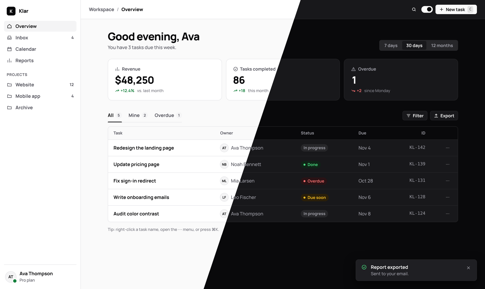

<p align="center">
  
</p>

<h1 align="center">Klar</h1>

<p align="center">
  A sharp, monochrome design system for React.<br>
  Tokens, 40 components, and themes for Tailwind v4 and shadcn/ui.
</p>

<p align="center">
  <a href="https://klar.vweje.dk"><strong>Website</strong></a> ·
  <a href="https://klar.vweje.dk/examples/">Live demo</a> ·
  <a href="docs/design-principles.md">Design principles</a> ·
  <a href="docs/patterns.md">Patterns</a> ·
  <a href="docs/components">Components</a>
</p>

<p align="center">
  <a href="LICENSE"></a>
  
  
  
</p>

---

Klar (Danish for *clear*) is black and white by design: thin borders, small radii, compact controls and bold type set in Manrope. There is no accent color - contrast does the work, and color only ever means status.

- **40 React components** - forms, tables, KPI cards, menus with submenus, context menus, a ⌘K command palette, dialogs, drawers and toast notifications.
- **Design tokens** as CSS variables, with light and dark mode out of the box.
- **Drop-in themes** for Tailwind v4 and shadcn/ui, so existing projects can adopt the look without a rewrite.
- **Zero dependencies** besides React 18+. Works with the Next.js App Router, Vite, or a plain `<script>` tag.
- **Accessible by default** - every text pair meets WCAG AA in both themes, with visible focus rings and keyboard support.

## Installation

```bash
npm install github:vweje/klar
```

## Quick start

Import the styles and add the toaster once, in your root layout:

```tsx
// app/layout.tsx
import 'klar/styles.css';
import { Toaster } from 'klar';

export default function RootLayout({ children }: { children: React.ReactNode }) {
  return (
    <html lang="en">
      <body>
        {children}
        <Toaster />
      </body>
    </html>
  );
}
```

Then use the components:

```tsx
'use client';

import { Button, Card, TextField, toast } from 'klar';

export function ProfileCard() {
  return (
    <Card eyebrow="Profile" title="Your details">
      <TextField label="Name" placeholder="Your full name" />
      <Button onClick={() => toast.success('Changes saved')}>Save</Button>
    </Card>
  );
}
```

The package ships with `"use client"`, so components without function props (`Card`, `Badge`, `Stat`, ...) also render inside server components. Anything that takes `onClick`, `onChange`, `render` or `onSelect` belongs in a client component.

## Components

| | |
| --- | --- |
| **Layout** | `Sidebar` `Topbar` `Tabs` `Pagination` |
| **Inputs** | `TextField` `Textarea` `Select` `SearchField` `Checkbox` `RadioGroup` `Switch` `Slider` `SegmentedControl` |
| **Data display** | `Table` `List` `ListRow` `Card` `Stat` `Badge` `Avatar` `AvatarGroup` `Accordion` `Tooltip` `Kbd` `Icon` |
| **Actions and menus** | `Button` `Menu` `MenuPanel` `ContextMenu` `CommandPalette` |
| **Overlays** | `Dialog` `Drawer` |
| **Feedback** | `Toaster` `toast()` `Toast` `Callout` `ProgressBar` `Skeleton` `Spinner` `EmptyState` |

Every component has usage guidelines in [`docs/components`](docs/components). Props are typed in [`dist/index.d.ts`](dist/index.d.ts).

### Examples

**Context menu with a submenu**

```tsx
<ContextMenu
  items={[
    { label: 'Rename', icon: 'edit', shortcut: 'F2' },
    { label: 'Status', icon: 'circle-check', items: [
      { label: 'In progress', checked: true },
      { label: 'Done', checked: false },
    ]},
    { separator: true },
    { label: 'Delete', icon: 'trash', danger: true, onSelect: () => remove(task.id) },
  ]}
>
  <TaskRow task={task} />
</ContextMenu>
```

**Toasts**

```tsx
toast('Link copied');
toast.success({ title: 'Task created', description: '"Redesign the landing page" was added.' });
toast({
  title: 'Project archived',
  action: <Button size="sm" variant="secondary" onClick={undo}>Undo</Button>,
  duration: 8000,
});
```

**Table**

```tsx
<Table
  columns={[
    { key: 'name', label: 'Task', strong: true },
    { key: 'status', label: 'Status', render: (row) => <Badge tone={row.tone}>{row.status}</Badge> },
    { key: 'id', label: 'ID', mono: true, align: 'right' },
  ]}
  rows={tasks}
  onRowClick={(row) => open(row.id)}
/>
```

## Theming

### Dark mode

- Set `data-theme="light"` or `data-theme="dark"` on `<html>`, or on any element to theme just that subtree.
- The `.dark` class works too, so [next-themes](https://github.com/pacocoursey/next-themes) works with `attribute="class"`.
- With neither, Klar follows the system preference.
- `setTheme('dark' | 'light' | 'system')` switches with one calm crossfade (View Transitions where the browser supports them) instead of every color changing on its own. With next-themes, use `disableTransitionOnChange` for the same effect.

### Tailwind v4

```css
/* app/globals.css */
@import "tailwindcss";
@import "klar/styles.css";
@import "klar/tailwind.css";
```

Every Klar color becomes a utility with the same name as its token:

```tsx
<div className="bg-surface border border-border rounded-lg p-5 text-text-secondary shadow-klar-md">
  ...
</div>
```

`bg-canvas`, `bg-surface`, `bg-fill`, `text-text`, `text-text-secondary`, `bg-primary`, `text-on-primary`, `text-success`, `bg-danger-soft` and so on. The `dark:` variant follows `data-theme="dark"` and `.dark`.

### shadcn/ui

Map Klar onto shadcn's variables and your existing shadcn components pick up Klar's colors, borders and radius:

```css
@import "tailwindcss";
@import "klar/tokens.css";
@import "klar/shadcn.css";
```

Use `klar/tokens.css` (variables only) instead of `klar/styles.css` when you want the look without Klar's own component styles.

### Customizing tokens

All values live in [`tokens/tokens.json`](tokens/tokens.json). Change a value, run `npm run build`, and it flows through to the CSS variables, the Tailwind theme and the shadcn theme.

## Language

Klar's built-in texts (placeholders and screen reader labels like "Search", "Close" and "No results for") are English by default. Everything else is text you pass in, so Klar works in any language.

Switch the built-in texts once, before your app renders:

```ts
import { setStrings } from 'klar';

setStrings('da');                 // bundled Danish
setStrings({ search: 'Suchen' }); // or your own texts, any subset
```

## Without a build step

```html
<link rel="stylesheet" href="https://cdn.jsdelivr.net/gh/vweje/klar@main/dist/klar.css">
<script src="https://cdnjs.cloudflare.com/ajax/libs/react/18.3.1/umd/react.production.min.js"></script>
<script src="https://cdnjs.cloudflare.com/ajax/libs/react-dom/18.3.1/umd/react-dom.production.min.js"></script>
<script src="https://cdn.jsdelivr.net/gh/vweje/klar@main/dist/klar.umd.js"></script>
<script>
  const { Button, toast } = window.Klar;
</script>
```

The [live demo](https://klar.vweje.dk/examples/) is a single HTML file built this way - see [`examples/index.html`](examples/index.html).

## Package exports

| Import | Contents |
| --- | --- |
| `klar` | React components, `toast()` and `setStrings()` |
| `klar/styles.css` | Tokens, component styles and the Manrope font |
| `klar/tokens.css` | CSS variables and type classes (`.k-h1`, `.k-body`, ...) only |
| `klar/components.css` | Component styles only |
| `klar/tailwind.css` | Tailwind v4 theme |
| `klar/shadcn.css` | shadcn/ui theme |
| `klar/tokens.json` | Every token as data |

## Development

```bash
git clone https://github.com/vweje/klar.git
cd klar
npm install
npm run build
```

Source lives in `src/` (components and CSS) and `tokens/tokens.json` (every value). `npm run build` generates `dist/`, which is committed so the package installs straight from GitHub. Open `examples/index.html` in a browser to see your changes.

## License

[MIT](LICENSE) © Viggo Weje
